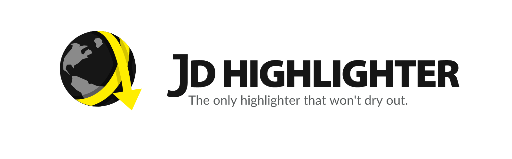
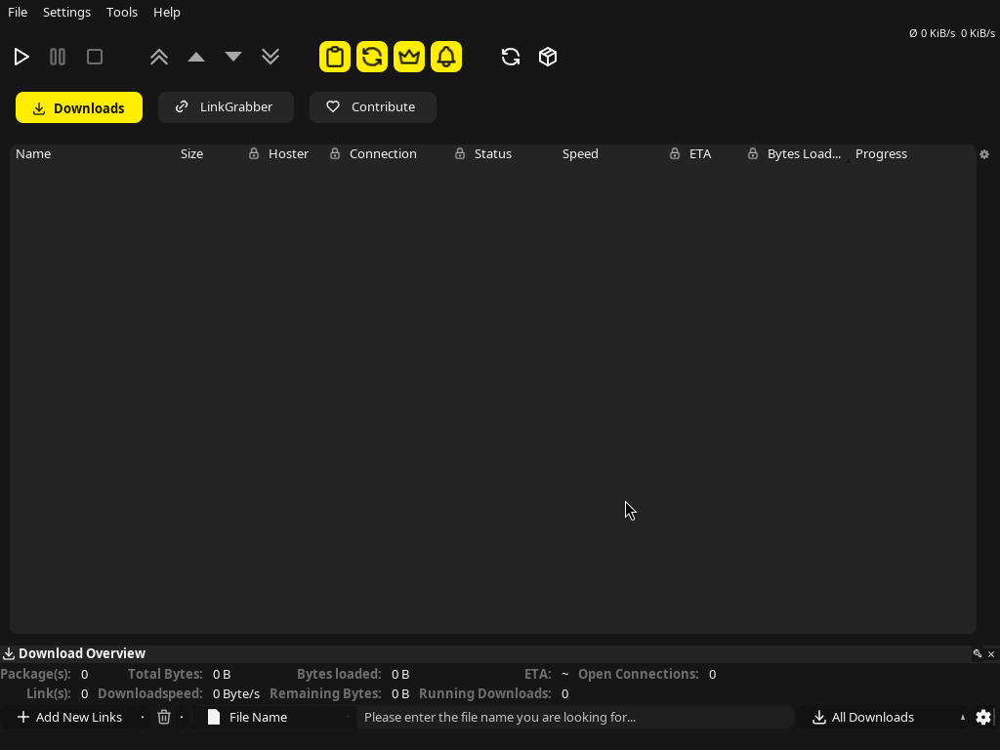
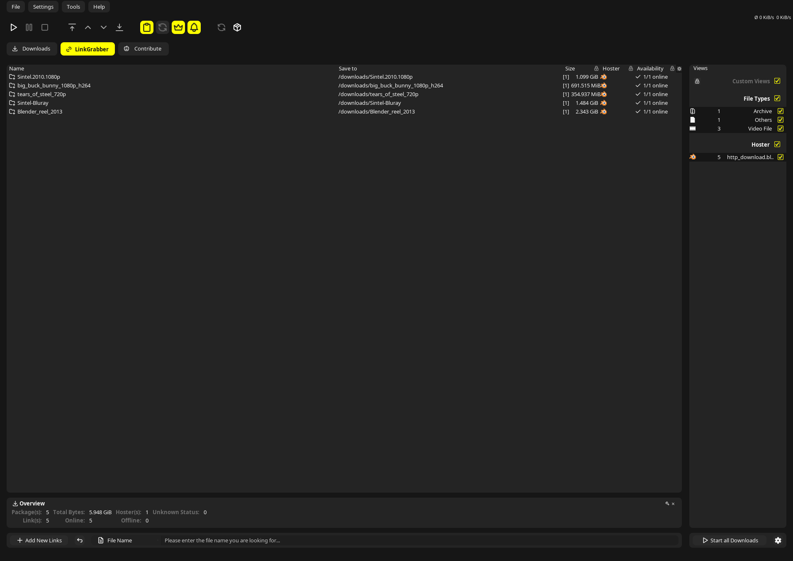
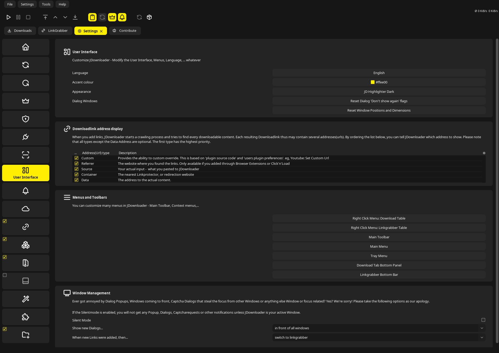
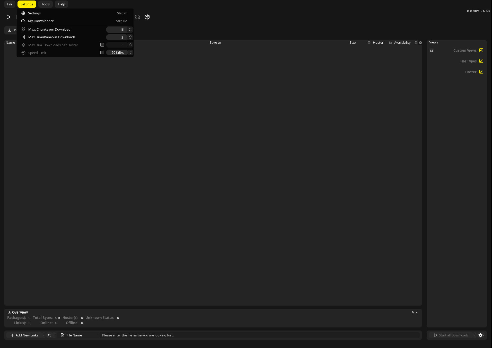
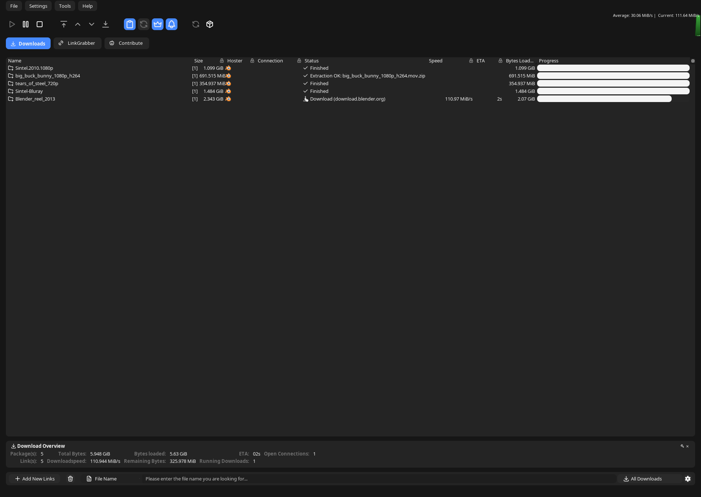

<p align="center">
  <picture>
    <source media="(prefers-color-scheme: dark)" srcset=".github/assets/banner-dark.png">
    
  </picture>
</p>

<p align="center">
  <a href="https://github.com/junkerderprovinz/jd-highlighter/actions/workflows/lint.yml"></a>&nbsp;
  <a href="https://github.com/junkerderprovinz/jd-highlighter/releases/latest"></a>&nbsp;
  <a href="https://github.com/junkerderprovinz/jd-highlighter/releases"></a>&nbsp;
  <a href="#3-install"></a>&nbsp;
  <a href="https://jdownloader.org"></a>&nbsp;
  <a href="LICENSE"></a>
</p>

<br>

<p align="center">
A <b>borderless</b>, freely-accented theme pair for <b>JDownloader 2</b>: <b>JD Highlighter Dark</b> on
IBM Carbon <code>#161616</code> and <b>JD Highlighter Light</b> on <code>#f4f4f4</code>, both with
<b>subtly rounded corners</b> and a single <b>user-chosen accent</b> that lights up the interactive
controls. Input fields are defined by <i>fill, not frames</i>; large fills stay neutral so text stays
readable at <i>any</i> accent hue. Works on the JDownloader <b>desktop app</b> and the <b>Docker container</b>.
</p>

<br>

<p align="center">
  <a href="https://buymeacoffee.com/junkerderprovinz"></a>
  &nbsp;
  <a href="https://www.paypal.com/donate/?hosted_button_id=76FVV52TKXTUS"></a>
  &nbsp;
  <a href="https://junkerderprovinz.github.io/junkerderprovinz/"></a>
</p>

<br>

## Table of Contents

1. [What it does](#1-what-it-does)
2. [Screenshots](#2-screenshots)
3. [Install](#3-install)
4. [How it works](#4-how-it-works)
5. [Uninstall](#5-uninstall)
6. [Credits](#6-credits)
7. [License](#7-license)
8. [Support this project](#8-support-this-project)

<br>

## 1. What it does

JDownloader 2 ships no proper dark mode, and even a dark Look & Feel leaves boxed inputs,
hard separators, grey controls and a toolbar full of colourful icons. **JD Highlighter** is a
complete visual redesign in neutral IBM Carbon greys, as **JD Highlighter Dark** (`#161616`)
and **JD Highlighter Light** (`#f4f4f4`). Both share the same layout:

- **Borderless.** Borders and separators take the colour of the surface behind them, so the
  lines disappear: no boxes, no hairline grid. Areas stand apart by shade instead.
- **Cards, not frames.** The download list, the link grabber and the settings sections sit on
  a rounded card (`#242424` in Dark, white in Light); fields are soft filled blocks without a frame.
- **One corner radius.** Buttons, fields, tabs, menus, cards and dialogs all round at 8px.
- **Clean line icons.** The chrome icons (toolbar, tabs, sidebar, section headers, status
  glyphs) become one consistent set of [Tabler](https://tabler.io/icons) line icons.
- **A single, free accent.** One colour you choose (any hex, default electric yellow `#ffee00`)
  lights up the toolbar toggles, the selected tab, menu and row hover, checkmarks, focus and
  the download progress bar. **Large text-bearing fills stay neutral**: the selected download
  row keeps a readable grey, so the look holds at any hue. Text on the accent is
  **auto-contrasted** (dark on a light accent, light on a dark one).

It works on **Windows, macOS and Linux** (via a small installer) and inside the
**JDownloader Docker container**, where JD Highlighter Dark is the default theme. It is a sibling to
[**jd-plain-dark**](https://github.com/junkerderprovinz/jd-plain-dark). Want the faithful,
accent-free "JD Plain in dark" instead? Use that one; JD Highlighter is the borderless, accented take.

<br>

## 2. Screenshots

<p align="center">
  
  <br>
  <em>The download list on its card, with the default electric-yellow accent <code>#ffee00</code>.</em>
</p>

<p align="center">
  
  <br>
  <em>The LinkGrabber: list, views column, overview and bottom bar each sit on their own card.</em>
</p>

<p align="center">
  
  <br>
  <em>Settings with full-height tiles, section cards and borderless fields.</em>
</p>

<p align="center">
  
  <br>
  <em>Menus with mono Tabler glyphs and the accent on hover.</em>
</p>

<p align="center">
  
  <br>
  <em>The same theme with one colour changed: a blue accent <code>#4589ff</code>. Large surfaces stay neutral.</em>
</p>

<br>

## 3. Install

JD Highlighter runs on the **desktop app** and in the **Docker container**. On both, the accent and
the look are picked in JD itself: **Settings → User Interface** has an **Accent colour** row with a
colour picker and an **Appearance** row. On the desktop it offers JD Highlighter Dark and JD
Highlighter Light; in the container also the container's other looks (see below). JD offers a restart after a
change, and the new look shows once it is back.

### Desktop (Windows / macOS / Linux)

1. Download `jd-highlighter-vX.Y.Z.zip` from the [latest release](https://github.com/junkerderprovinz/jd-highlighter/releases/latest) and unzip it.
2. Run the installer for your OS:
   - **Windows:** double-click **`install/install.bat`** (recommended). It keeps the window open
     and, if it can't find JDownloader automatically, **asks you for the folder**. Right-click
     `install/install.ps1` → *Run with PowerShell* works as well.
   - **Linux / macOS:** `sh install/install.sh "/path/to/JDownloader"`
     (the folder that contains `cfg`). Without an argument it auto-detects and prompts if it can't.

   Either installer sets up JD Highlighter Dark by default. For JD Highlighter Light, pass
   `-Variant light` on Windows or `light` as the third argument on Linux / macOS (see below).
3. **Restart JDownloader.** If you have never used one of JD's FlatLaf designs before, JD
   downloads it on this start and restarts once more by itself. The theme appears as soon as
   FlatLaf is running.

The installer writes the Carbon colours into JD's `cfg/laf/`, selects the `FLATLAF_DARK`
Look & Feel (`FLATLAF_LIGHT` for Light) and switches off JD's built-in ads. Into
`<JD>/.jd-highlighter/` it renders the accented control theme (`FlatDarkLaf.properties` or
`FlatLightLaf.properties`) and copies the theme agent (`jd-highlighter-agent.jar`) with its
icons and the templates it renders from when you change the accent or the variant in JD. Two
lines in JDownloader's install4j `.vmoptions` (`JDownloader2.vmoptions`, or
`Contents/vmoptions.txt` inside the macOS bundle) load the agent; running the installer again
replaces them instead of adding more.

**Start with another variant or accent (desktop).** The installer takes both as a starting point;
later changes go through JD's settings as above:

```sh
# Linux / macOS: the second argument is the accent, the third the variant
sh install/install.sh "/path/to/JDownloader" "#4589ff" light
```

```powershell
# Windows: -Accent and -Variant (install.bat passes them on)
install\install.bat -Accent "#4589ff" -Variant light
```

If JDownloader is installed in a read-only folder, the installer writes the lines to
`<JD>/.jd-highlighter/jd-highlighter.vmoptions` and prints the one line to add
(`-include-options …`), with `JAVA_TOOL_OPTIONS` as the last-resort fallback.

### Container (Docker / Unraid)

Both themes are bundled in the [JDownloader-for-Unraid container](https://github.com/junkerderprovinz/jdownloader),
and JD Highlighter Dark is its default. The **Appearance** row in JD's settings offers all of the
container's looks: JD Highlighter Dark, JD Highlighter Light, JD Plain Dark (the plain Carbon
look), FlatLaf Light and JD Default (JDownloader's classic look). The pick and the accent are kept in `/config/.jd-highlighter`, so
they survive image updates. `JD_THEME` only sets the look a container starts with until one is
picked in JD:

| Variable | Default | Meaning |
|---|---|---|
| `JD_THEME` | `jd-highlighter-dark` | `jd-highlighter-dark` (also `Dark`), `jd-highlighter-light`, `plain-dark`, `Light` or `JDDEFAULT` |

Before each JD start the theme script writes the accent into the control theme and computes the
auto-contrast button text.

<br>

## 4. How it works

JDownloader paints in **two separate paths**, and some of its look is hard-coded, so JD
Highlighter works on three levels:

| Surface | Mechanism | File |
|---|---|---|
| Download list, link grabber, settings table, panels, tooltips, scrollbars | JD's own `colorfor*` config | `theme/cfg/laf/FlatDarkLaf.json`, `FlatLightLaf.json` |
| Buttons, checkboxes, toggles, fields, combos, tabs, menus, borders, accent, corner radius | FlatLaf custom-defaults `.properties` | `theme/flatlaf/FlatDarkLaf.properties.tmpl`, `FlatLightLaf.properties.tmpl` |
| Icons, cards, menu badges, dialogs, progress rings, everything JD hard-codes | a Java agent | `agent/` |

The **JSON** is the Carbon palette JDownloader reads itself. The **`.properties`** holds the
borderless colours, the fill-based fields, the rounded corners and the `@accentColor` that
cascades through the controls. The installer fills the accent and its auto-contrast colour into
both at apply time.

The **agent** (`jd-highlighter-agent.jar`, compiled for Java 8, so it loads on every Java that JDownloader ships with) registers the
`.properties` with FlatLaf and then reworks what no theme key reaches: it swaps the chrome icons
for the Tabler set, lays the lists onto rounded cards, turns menus and dialogs borderless and
replaces JD's coloured progress globes with a plain accent ring. JDownloader's own jars stay
untouched. The agent is the same one the
[JDownloader-for-Unraid container](https://github.com/junkerderprovinz/jdownloader) runs;
`agent/UPSTREAM` names the container commit it comes from.

JD Highlighter Dark runs on `FLATLAF_DARK` and JD Highlighter Light on `FLATLAF_LIGHT`, each
with its own colours and control values on top. The agent, the layout and the icons are the
same for both; the variant only picks the palette.

<br>

## 5. Uninstall

### Desktop

Run the uninstaller for your OS (it auto-detects JDownloader, or takes the folder as an argument):

- **Windows:** right-click `install/uninstall.ps1` → *Run with PowerShell*.
- **Linux / macOS:** `sh install/uninstall.sh "/path/to/JDownloader"`

It removes exactly the JD Highlighter lines (and any `-include-options` redirect) from the
`.vmoptions` and deletes the `<JD>/.jd-highlighter/` directory. The Look & Feel and the theme
JSON in `cfg/laf/` stay as they are; to fully revert, pick another theme under
**Settings → GUI → Look & Feel** and restart JDownloader.

### Container

Set `JD_THEME` to `plain-dark`, `Light` or `JDDEFAULT` and restart the container.

<br>

## 6. Credits

The two-path technique, overriding JDownloader's native `colorfor*` config for the content areas
and loading a FlatLaf custom-defaults `.properties` for the controls, comes from the dark theme
built into the [JDownloader-for-Unraid container](https://github.com/junkerderprovinz/jdownloader).
The chrome icons are [Tabler Icons](https://tabler.io/icons) (MIT, see
`theme/jd-tabler/LICENSE.tabler`). The agent bundles [ASM](https://asm.ow2.io/) (BSD-3-Clause, see `agent/LICENSE.asm`).
Sibling to [jd-plain-dark](https://github.com/junkerderprovinz/jd-plain-dark).

<br>

## 7. License

**Copyright (C) 2026 Junker der Provinz.**

JD Highlighter is free software under the **GNU Affero General Public License v3.0** (AGPL-3.0); see [LICENSE](LICENSE). You may run, study, share and modify it. If you distribute it, or run a modified version as a network service, you must release your source under the same AGPL-3.0 terms and keep the existing copyright and attribution notices intact.

**Name and branding are not licensed.** The AGPL covers the source code only. "JD Highlighter", its logo and its branding remain reserved: a fork or derivative must use its own distinct name and branding, and may not present itself as JD Highlighter. This keeps it unambiguous which project is the original.

<br>

## 8. Support this project

If this made JDownloader a little easier on the eyes, you can

<p align="center">
  <a href="https://buymeacoffee.com/junkerderprovinz"></a>
  &nbsp;
  <a href="https://www.paypal.com/donate/?hosted_button_id=76FVV52TKXTUS"></a>
  &nbsp;
  <a href="https://junkerderprovinz.github.io/junkerderprovinz/"></a>
</p>

Issues and suggestions: [GitHub Issues](https://github.com/junkerderprovinz/jd-highlighter/issues).
